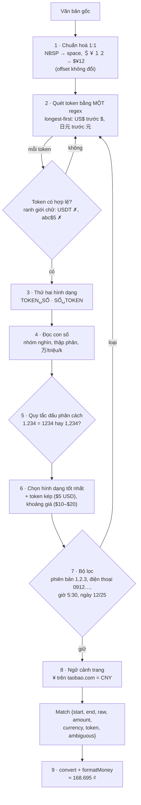

# TransPrice — Thuật toán nhận diện và quy đổi giá

> Tài liệu này giải thích **từng bước** cách TransPrice tìm ra giá tiền trong một trang web (`¥189`, `$1,299.99`,
> `12,99 €`, `1,2 triệu đ`…) và đổi sang tiền tệ của bạn (ví dụ VND). Viết cho lập trình viên chưa từng làm mảng này.
> Tên hàm, biến trong code giữ nguyên tiếng Anh.
>
> - Hợp đồng API (chữ ký hàm, kiểu dữ liệu): [`ARCHITECTURE.md` §4](ARCHITECTURE.md)
> - Code: [`extension/src/shared/currency-data.js`](../extension/src/shared/currency-data.js) (dữ liệu tiền tệ) và
>   [`extension/src/content/parser.js`](../extension/src/content/parser.js) (bộ phân tích — thuần JS, không DOM)
> - Thử trực tiếp: `npm run dev` → **Algorithm playground** (`dev/playground.html`)
> - Kiểm thử: `node --test tests/engine/` (≈ 290 ca)

---

## Mục lục

1. [Bức tranh tổng thể](#1-bức-tranh-tổng-thể)
2. [Chuẩn hoá văn bản](#2-chuẩn-hoá-văn-bản)
3. [Token tiền tệ](#3-token-tiền-tệ)
4. [Ngữ pháp con số](#4-ngữ-pháp-con-số)
5. [Dấu chấm hay dấu phẩy? — quy tắc phân cách](#5-dấu-chấm-hay-dấu-phẩy--quy-tắc-phân-cách)
6. [Hình dạng của một giá (shapes)](#6-hình-dạng-của-một-giá-shapes)
7. [Loại bỏ những thứ không phải giá](#7-loại-bỏ-những-thứ-không-phải-giá)
8. [Ngữ cảnh trang — `$` và `¥` nghĩa là gì?](#8-ngữ-cảnh-trang--và--nghĩa-là-gì)
9. [Quy đổi và hiển thị](#9-quy-đổi-và-hiển-thị)
10. [Trong trang web thật: content script](#10-trong-trang-web-thật-content-script)
11. [Ví dụ trọn vẹn: thẻ sản phẩm Taobao `¥43.65` → `≈ 168.695 ₫`](#11-ví-dụ-trọn-vẹn-thẻ-sản-phẩm-taobao-4365---168695-)
12. [Hiệu năng](#12-hiệu-năng)
13. [Giới hạn đã biết và ý tưởng](#13-giới-hạn-đã-biết-và-ý-tưởng)

---

## 1. Bức tranh tổng thể

Ý tưởng cốt lõi: **một con số chỉ là giá khi đứng cạnh một ký hiệu tiền tệ**. Vì vậy thuật toán không đi tìm
số trước, mà đi tìm **token tiền tệ** (`¥`, `$`, `USD`, `元`, `đ`…) rồi nhìn sang hai bên token xem có con số hợp lệ
không. Trang Taobao có rất nhiều số (`5 people bought`, `10 off over 198`, `2027`) nhưng chỉ số nào dính với `¥` mới
được coi là giá.



API công khai (`globalThis.TransPriceParser`):

| Hàm | Dùng để |
|---|---|
| `quickTest(text)` | Lọc siêu rẻ: có chữ số **và** có token không? Chạy trên mọi text node. |
| `hasToken(text)` | Chỉ cần có token (để bắt đầu "leo cây" tìm giá bị tách — §10). |
| `findPrices(text, ctx)` | Mọi giá trong một đoạn văn, không chồng lấn, trái → phải. |
| `parsePrice(text, ctx)` | **Toàn bộ** chuỗi (đã trim) đúng là một giá — dùng cho giá bị tách thành nhiều thẻ. |
| `parseNumber(str, opts)` | Đọc một con số trần (`1.234,56`, `1,5 triệu`) theo cùng quy tắc. |
| `resolveContext({hostname, lang, sampleText, settings})` | Xác định `$`, `¥`, `kr` và dấu thập phân của trang. |
| `convert`, `formatMoney`, `rateText` | Quy đổi theo bảng tỷ giá gốc USD và định dạng bằng `Intl`. |

---

## 2. Chuẩn hoá văn bản

Trang web dùng rất nhiều ký tự "trông giống" nhau:

| Gốc | Thành | Ghi chú |
|---|---|---|
| `U+00A0` NBSP, `U+202F` narrow NBSP, `U+2009` thin space, `U+3000` khoảng trắng CJK, ZWSP | dấu cách | `1 234,56 €` kiểu Pháp/Đức |
| `１２３` (chữ số full-width) | `123` | Trang Nhật/Trung |
| `＄` `￥` `￡` `￦` `．` `，` `～` | `$` `¥` `£` `₩` `.` `,` `~` | |

**Điểm mấu chốt:** mỗi ký tự được thay bằng **đúng một** ký tự (cùng độ dài UTF-16), nên vị trí trong chuỗi đã
chuẩn hoá **trùng khớp** vị trí trong chuỗi gốc. Nhờ đó `start`/`end` của kết quả luôn trỏ vào văn bản gốc:
`text.slice(m.start, m.end)` cho ra đúng `'1 234,56 €'` với các khoảng trắng đặc biệt, hay `'￥１，２８０'` nguyên dạng.
Trường `token` cũng là token "như được viết" (`'￥'`, không phải `'¥'`).

Riêng khoảng trắng "kiểu chữ" (NBSP, U+202F, thin space) vẫn được nhận ra khi cần — bằng cách nhìn vào chuỗi gốc ở
cùng vị trí — vì nó là dấu nhóm nghìn chắc chắn hơn dấu cách thường (xem §4).

---

## 3. Token tiền tệ

`TransPriceCurrencies.TOKENS` liệt kê mọi dấu hiệu tiền tệ nhận diện được (≈ 257 token):

```js
{ token: 'US$', currencies: ['USD'], kind: 'symbol', prefix: true, suffix: true }
{ token: '元',  currencies: ['CNY'], kind: 'word',   prefix: false, suffix: true }   // chỉ đứng sau số: 189元
{ token: '$',   currencies: ['USD','CAD','AUD','NZD','SGD','HKD','TWD','MXN'], ... } // mơ hồ → ngữ cảnh quyết định
```

- **Ký hiệu**: `$ ¥ € £ ₩ ₹ ฿ ₱ ₺ ₽ ₪ ₴ ₦ ₫ ₸ …`, dạng có tiền tố `US$ HK$ NT$ S$ C$ A$ NZ$ MX$ R$ CN¥ JP¥`,
  viết tắt địa phương `zł Kč Ft kr RM Rp Rs lei TL S/ Fr.`, full-width `＄ ￥`.
- **Từ**: `元 圆 円 원 đ đồng 人民币 日元 美元 欧元 yuan yen euro baht dollars…`
- **Mã ISO**: gần như toàn bộ 161 mã của bảng tỷ giá (`USD 12.99`, `12.99 USD`) — **trừ** những mã trùng từ tiếng Anh
  viết hoa (`TOP 10`, `ALL 5`, `CVE-2024`, `XDR`); vài mã chỉ được đứng sau số (`TRY 7 DAYS FREE` không phải 7 lira,
  nhưng `150 TRY` thì đúng).

### Một regex duy nhất, dựng một lần

Khi `parser.js` được nạp, toàn bộ token được ghép thành **một** biểu thức chính quy dạng **cây tiền tố (trie)**.
Regex này được dùng lại cho mọi lời gọi — không bao giờ dựng lại:

```
(?<![chữ])(?:U(?:S(?:\$|D(?![chữ])| \$)|…)|R(?:M|p\.?|s\.?|…)|…)  |  \$  |  ¥  |  元  |  日元  |  …
└─ mọi token bắt đầu bằng chữ cái: CHUNG một lookbehind ─┘            └─ token bắt đầu bằng ký hiệu ─┘
```

- **Dài trước – ngắn sau**: tại mỗi nút của cây, nhánh đi tiếp (token dài hơn) được thử trước lựa chọn "token kết thúc
  ở đây". Vì vậy `US$` thắng `$`, `CN¥` thắng `¥`, `kr.` thắng `kr`, `日元` thắng `元`, đúng như một danh sách sắp
  xếp từ dài đến ngắn.
- **Ranh giới chữ**: token bắt đầu/kết thúc bằng chữ cái (Latin, tiếng Việt, Cyrillic, Ả Rập) cần ranh giới chữ.
  Vì vậy `USD` khớp, còn `USDT`, `Skr`, `Mrs` thì không; `đ` trong `đi được` cũng không. Có cần lookbehind hay không
  chỉ phụ thuộc vào **ký tự đầu**, nên mọi token bắt đầu bằng chữ cái dùng **chung một** `(?<![chữ])`. Lookahead
  `(?![chữ])` gắn vào nút cuối của token kết thúc bằng chữ cái.
- Chữ Hán/Thái **không** tính là ranh giới (tiếng Trung không có dấu cách: `价格¥189起` phải khớp).

Vì sao không ghép ~260 token thành một danh sách `A|B|C|…` phẳng? Bản đầu tiên làm vậy, và V8 đời cũ (Node 22,
Chrome ≤ 124, mà manifest vẫn cho phép từ Chrome 116) thử **từng nhánh ở từng vị trí**: chậm hơn 15–75 lần
(quét 1 MB: ~750 ms so với ~10 ms). Dạng trie cho phép engine rẽ nhánh ngay theo ký tự đầu. Test
`token trie ≡ the flat longest-first alternation` so sánh hai cách trên mọi cửa sổ của một đoạn văn mẫu để chắc
chắn kết quả giống hệt.

`quickTest` và `hasToken` còn có hai bộ lọc rẻ chạy trước regex: không có chữ số thì trả `false` ngay (chỉ
`quickTest`), không có ký tự nào thuộc tập "ký tự đầu của token" thì cũng trả `false` ngay.

Một ký hiệu dính sau một từ (`abc$5`, `Price$5`) không thể mở đầu một giá — trừ khi từ đó chính là token (`USD$5`).

---

## 4. Ngữ pháp con số

Bắt đầu từ chữ số đầu tiên, đọc các **cụm chữ số** nối với nhau bởi **một** dấu phân cách:

| Dấu | Ví dụ | Vai trò |
|---|---|---|
| `.` `,` | `1,299.99` · `1.234,56` · `12,34,567.89` | nhóm nghìn **hoặc** thập phân (§5) |
| `'` `’` | `1'234.50` (Thuỵ Sĩ) | chỉ nhóm nghìn |
| khoảng trắng kiểu chữ | `1 234,56` (NBSP) | chỉ nhóm nghìn |
| dấu cách thường | `1 234 €` | nhóm nghìn — có điều kiện (xem dưới) |

Kiểm tra cấu trúc nhóm:

- **Kiểu phương Tây**: cụm đầu 1–3 chữ số, các cụm sau đúng 3 chữ số (`1.234.567`).
- **Kiểu Ấn Độ** (dấu phẩy): cụm đầu 1–2, giữa 2, cuối 3 (`12,34,567` = 1 234 567).
- Nếu cả chuỗi không hợp lệ, thử **cắt bớt cụm cuối** cho tới khi hợp lệ: `¥43.65 5` → `43.65`.
- **Dấu cách thường** sau token (`¥189 100人付款`) dễ là hai số khác nhau ("¥189", "100 người mua"), nên ở dạng
  `TOKEN SỐ` nó chỉ được coi là nhóm nghìn khi có phần thập phân theo sau (`€ 1 234,56`) hoặc dấu `,-`.
  Ở dạng `SỐ TOKEN` (`1 234 €`) thì được chấp nhận vì token đứng ngay sau xác nhận cả cụm.
- Số **bắt đầu bằng 0 rồi tới chữ số khác** (`0912…`, `007`) bị loại: đó là số điện thoại / mã. `0,99` thì hợp lệ.
- `.99` (không có phần nguyên) không phải giá. Tối đa 15 chữ số phần nguyên.
- `,-` hoặc `.–` sau số = "không có phần lẻ" (kiểu Bắc Âu `kr 1 299,-`, Thuỵ Sĩ `Fr. 12.–`).

### Hệ số nhân (multiplier)

Ngay sau con số có thể có một hệ số — **chỉ khi có token tiền tệ đi kèm** (vì vậy `Giá 199k` không phải giá, còn
`99k₫` là 99 000 ₫):

| Hệ số | ×  | Ví dụ |
|---|---|---|
| `万` `萬` / `만` | 10⁴ | `1.5万円` = 15 000 JPY · `1만원` = 10 000 KRW |
| `亿` `億` / `억` | 10⁸ | |
| `千` / `천` | 10³ | |
| `k` `K` | 10³ | `$5k` (phải dính liền số) |
| `M` `m` `mn` · `B` `bn` | 10⁶ · 10⁹ | `£5m`, `$2bn` |
| `tr` `triệu` · `tỷ` `tỉ` · `nghìn` `ngàn` | 10⁶ · 10⁹ · 10³ | `1,2 triệu đ` = 1 200 000 ₫ |
| `thousand` `million` `billion` `trillion` | 10³ · 10⁶ · 10⁹ · 10¹² | `$1.5 million` |
| `lakh` · `crore` | 10⁵ · 10⁷ | `₹5 lakh` |
| `Mio.` · `Mrd.` | 10⁶ · 10⁹ | |

Hệ số chữ cái phải kết thúc ở ranh giới từ: `$5 months` vẫn là `$5`, không phải 5 triệu.

---

## 5. Dấu chấm hay dấu phẩy? — quy tắc phân cách

Đây là phần khó nhất: `1.234` là "một nghìn hai trăm ba mươi tư" (Đức, Việt Nam) hay "một phẩy hai ba bốn" (Mỹ)?

1. **Có cả `.` và `,`** → dấu xuất hiện **sau cùng** là dấu thập phân, và nó chỉ được xuất hiện một lần:
   `1.234,56` = 1234.56 · `1,234.56` = 1234.56.
2. **Một loại dấu lặp lại** → nhóm nghìn: `1.234.567` = 1234567.
3. **Một dấu duy nhất, sau nó 1–2 chữ số** → thập phân: `12,99` = 12.99 · `3.6` = 3.6.
4. **Một dấu duy nhất, sau nó đúng 3 chữ số** → cần quyết định (bảng dưới). Thứ tự xét:
   1. tiền tệ **không có phần lẻ** (VND, JPY, KRW, IDR, CLP, HUF, TWD…) → nhóm nghìn;
   2. ngữ cảnh trang cho biết dấu này **là** dấu thập phân (`ctx.decimal`) → thập phân;
   3. ngữ cảnh cho biết dấu thập phân là **dấu còn lại** → nhóm nghìn;
   4. tiền tệ có **3** chữ số lẻ (KWD, BHD, OMR, JOD…) → thập phân;
   5. còn lại → **nhóm nghìn** (giá có đúng 3 chữ số lẻ với tiền tệ 2 chữ số lẻ là cực hiếm).

| Đầu vào | Tiền tệ | `ctx.decimal` | Kết quả | Lý do |
|---|---|---|---|---|
| `1.234` | VND / JPY | bất kỳ | **1234** | tiền tệ không có phần lẻ |
| `1,234` | KRW | bất kỳ | **1234** | tiền tệ không có phần lẻ |
| `1.234` | EUR | `,` (trang tiếng Đức) | **1234** | dấu thập phân là dấu còn lại |
| `1,234` | USD | `.` (trang tiếng Anh) | **1234** | dấu thập phân là dấu còn lại |
| `1.234` | USD | `.` | **1.234** | trang nói `.` là thập phân |
| `1,234` | EUR | `,` | **1.234** | trang nói `,` là thập phân |
| `1.234` | EUR | không rõ | **1234** | mặc định: nhóm nghìn |
| `1,234` | USD | không rõ | **1234** | mặc định: nhóm nghìn |
| `1.234` | KWD | không rõ | **1.234** | tiền tệ 3 chữ số lẻ |
| `1.23` / `1,5` | bất kỳ | bất kỳ | **1.23** / **1.5** | 1–2 chữ số sau dấu → thập phân |
| `1.234,5` | bất kỳ | bất kỳ | **1234.5** | có cả hai dấu → dấu sau cùng là thập phân |

> ⚠️ Khác biệt nhỏ so với bản tóm tắt trong `ARCHITECTURE.md` §4.3.5: bản tóm tắt ghi "còn lại → thập phân". Khi trang
> **không** cho biết dấu thập phân, code chọn **nhóm nghìn**, vì `$1,234` hay `1.234 €` gần như luôn là 1234 — đọc
> thành 1,234 sẽ sai gấp nghìn lần. Khi trang có `ctx.decimal`, hai cách hiểu trùng nhau.

`CURRENCIES[code].decimals` là "số chữ số lẻ dùng thực tế trên nhãn giá": theo ISO 4217 / CLDR, nhưng = 0 với những
đồng mà phần lẻ đã không còn dùng (IDR, HUF, TWD, COP, KZT…). Nó vừa quyết định quy tắc trên, vừa quyết định cách hiển thị.

---

## 6. Hình dạng của một giá (shapes)

Với mỗi token tìm thấy, thử hai hình dạng:

| Hình dạng | Ví dụ |
|---|---|
| `TOKEN␣?SỐ` | `¥189`, `USD 12.99`, `Rp 15.000`, `R$ 1.234,56` |
| `SỐ␣?TOKEN` | `189元`, `12,99 €`, `50.000đ`, `1.5万円`, `99 kr` |
| `-TOKEN SỐ` | `-$5` → giá `$5` (dấu âm bị bỏ qua, giá luôn dương) |
| khoảng `A␣?[-–~〜]␣?B` | `¥10-20`, `10–20 €`, `¥1-2万` (hệ số áp cho cả hai), `$10 - $20`, `10€ – 20€` |

`␣?` = không có hoặc có khoảng trắng. Một chuỗi khoảng trắng ngắn (≤ 16 ký tự, tối đa một xuống dòng) được coi như một
dấu cách vì HTML gộp mọi khoảng trắng: `¥\n      43.65` trong một text node vẫn hiển thị là `¥ 43.65`.

Mỗi token có cờ `prefix`/`suffix` cho biết được phép đứng trước/sau số (`元` chỉ đứng sau, `Rp` chỉ đứng trước).

### Khi cả hai phía đều có số

`12,99 € 5,99 €` — token `€` đầu tiên có số ở cả bên trái (`12,99`) lẫn bên phải (`5,99`). Thứ tự quyết định:

1. Nếu số bên phải lại **đứng ngay trước một token cùng loại** → nó thuộc về giá kế tiếp, chọn bên trái.
   (`12,99 € 5,99 €` → `12,99 €` và `5,99 €`.)
2. Nếu bên phải là cùng một giá viết hai lần (`$5 USD`) → chọn bên phải.
3. Phía **sát** token (không có dấu cách) thắng: `Qty 5 $10` → `$10`.
4. Số "trông giống giá" hơn (có phần thập phân/nhóm nghìn) thắng: `Qty 2 USD 12.99` → `USD 12.99`.
5. Còn hoà: `€`, `kr`, `₫` và mã ISO ưu tiên bên trái; các token khác ưu tiên bên phải.

### Token kép

Hai token quanh một con số, nếu khớp nhau, gộp thành một giá — token **cụ thể hơn** quyết định tiền tệ (và giá không
còn "mơ hồ"):

- `$5 USD`, `$12.99 CAD` → USD, CAD (dù `$` trên trang này nghĩa là gì)
- `USD $5`, `CAD $12.99`, `RMB ¥189`, `USD$5`
- `¥189元` → CNY ngay cả trên trang Nhật; `人民币1.5万元` → 15 000 CNY

### Khoảng giá

Hai giá cùng tiền tệ chỉ cách nhau một gạch nối được gộp thành khoảng (`amount` = đầu, `amountMax` = cuối) — chỉ khi
số sau **lớn hơn** số trước, nên `$10-$5` vẫn là hai giá riêng.

---

## 7. Loại bỏ những thứ không phải giá

| Trường hợp | Ví dụ | Cách loại |
|---|---|---|
| Số không có token | `5 people bought`, `10 off over 198`, `2027` | không có token → không bao giờ được xét |
| Token không có số | `the price in USD`, `¥` | không có hình dạng nào khớp |
| Token nằm trong từ | `USDT 5`, `Skr`, `abc$5`, `đi được` | ranh giới chữ (§3) |
| Template | `${price}` | sau `$` là `{`, không phải số |
| Phiên bản | `v1.2.3`, `$1.2.3` | `1.2.3` không phải nhóm hợp lệ; sau `1.2` còn `.3` → bị loại |
| Điện thoại / mã | `0912 345 678`, `$0912345678`, `+84 …` | số 0 đứng đầu, dấu `+` phía trước |
| Giờ, ngày, phần trăm | `5:30 $`, `$12/25`, `$5%` | ký tự ngay trước/sau số |
| Số dính chữ | `$5x`, `$5km`, `x2 €` | sau/ trước số là chữ cái (trừ hệ số và token) |
| Mã trùng từ tiếng Anh | `TOP 10`, `TRY 7 DAYS FREE` | bị chặn hoặc chỉ được đứng sau số |
| Feet ≠ forint | `50 Ft hose` | `Ft` cần số ≥ 100 |

---

## 8. Ngữ cảnh trang — `$` và `¥` nghĩa là gì?

`¥189` trên Taobao là **nhân dân tệ**, trên Amazon Nhật là **yên**. `$` có thể là USD, CAD, AUD, SGD… `kr` có thể là
SEK, NOK, DKK, ISK. `resolveContext()` được gọi **một lần cho mỗi trang** và trả về:

```js
{ dollar: 'USD', yen: 'CNY', kr: 'SEK', decimal: '.',
  reasons: { dollar: 'default', yen: 'domain', decimal: 'domain' } }   // Reason = 'site-pin'|'domain'|'lang'|'script'|'default'
```

Với mỗi trường, **nguồn đầu tiên có thông tin sẽ thắng**:

| # | Nguồn | `$` | `¥` | Dấu thập phân |
|---|---|---|---|---|
| 1 | **Ghim theo trang** `settings.siteCurrency[host]` (khớp host hoặc subdomain, bỏ `www.`, khoá dài nhất thắng) | ✓ | ✓ | – |
| 2 | **Tên miền** | `.ca` CAD · `.com.au` AUD · `.co.nz` NZD · `.sg` SGD · `.com.hk` HKD · `.tw` TWD · `.com.mx` MXN | `taobao.com tmall.com 1688.com jd.com aliexpress.com pinduoduo.com …` và `*.cn` → CNY · `*.jp`, `amazon.co.jp`, `rakuten.co.jp` → JPY | theo locale của tên miền (`.vn` → `,`, `.de` → `,`, `.cn` → `.` …) |
| 3 | **`<html lang>`** | vùng trong thẻ: `en-CA`/`fr-CA` → CAD, `zh-TW` → TWD, `es-MX` → MXN … | `ja` → JPY · `zh*` → CNY | `Intl.NumberFormat(lang)` (`vi` → `,`, `de-CH` → `.`) |
| 4 | **Chữ viết trong văn bản mẫu** (title + ~3 000 ký tự đầu) | – | có kana (ひらがな/カタカナ) → JPY · chữ Hán không kana → CNY | CJK → `.` · dấu tiếng Việt / Cyrillic → `,` |
| 5 | **Mặc định của người dùng** `settings.defaultDollar` / `defaultYen` | USD | CNY | không rõ (`null`) |

`kr`: tên miền `.se/.no/.dk/.is` → ngôn ngữ (`sv nb nn da is`) → SEK.

Một vài lựa chọn có chủ đích:

- `lang="en"` (không có vùng) **không** quyết định `$` — nhiều trang để mặc định `en`, và người dùng Úc đã chọn
  `defaultDollar = AUD` không muốn bị ép về USD.
- Văn bản tiếng Trung đôi khi chèn `の` cho "sang" (`日系の连衣裙`): chỉ coi là tiếng Nhật khi kana chiếm ≥ 10% chữ CJK.
- Tên miền đứng trước `lang`, vì rất nhiều trang `.vn` để nhầm `lang="en"`.
- `reasons` được popup hiển thị ("¥ trên trang này = CNY · nhận từ tên miền") và người dùng có thể ghim lại.

Giá có `ambiguous: true` là giá mà tiền tệ đến từ ngữ cảnh (`$`, `¥`, `kr` trần), không phải từ chính token.

---

## 9. Quy đổi và hiển thị

**Quy đổi** — bảng tỷ giá lưu "số đơn vị của mỗi đồng cho 1 USD" (`rates.USD = 1`):

```
convert(amount, from, to) = amount / rates[from] × rates[to]
```

Trả về `null` nếu thiếu tỷ giá (content script khi đó bỏ qua giá này).

**Định dạng** — `formatMoney(value, code, { locale, compact })` dùng `Intl.NumberFormat`:

- `style: 'currency'`, `currencyDisplay: 'narrowSymbol'`, số chữ số lẻ = `CURRENCIES[code].decimals`
  → `730.373 ₫` (vi-VN), `$5.39`, `¥12,800`, `₹12,34,567.89`, `1.234,50 €`.
- Số rất nhỏ khác 0 giữ 2 chữ số có nghĩa thay vì làm tròn về 0: `$0.0039`, không phải `$0.00`.
- `compact: true` → `notation: 'compact'`: `730 N ₫`, `$1.2K`.
- Locale mặc định: `TransPriceCurrencies.localeFor(code, navigator.languages)` — locale đầu tiên của trình duyệt có vùng
  dùng đồng tiền đó, nếu không thì "quê nhà" của đồng tiền (VND → `vi-VN`, JPY → `ja-JP`, EUR → `de-DE`).
- Các `Intl.NumberFormat` được cache (tạo mới tốn ~0.1 ms, còn gọi `format` gần như miễn phí).

**Dòng tỷ giá** — `rateText('CNY', 'VND', rates)` → `1 CNY = 3.865 ₫` (4 chữ số có nghĩa; ≥ 10 000 thì làm tròn hàng đơn vị).

Quy tắc dễ đọc: nếu **1 đơn vị `from` đáng giá dưới 0,01 `to`**, tức dòng tỷ giá sẽ bắt đầu bằng `0,00…`, thì
`rateText` **đảo chiều**:

| Gọi | Kết quả | Ghi chú |
|---|---|---|
| `rateText('VND', 'CNY', rates)` | `1 CNY = 3.865 ₫` | thay vì `1 VND = ¥0.0002588` |
| `rateText('VND', 'USD', rates)` | `1 USD = 25.789 ₫` | thay vì `1 VND = $0.00003878` |
| `rateText('IDR', 'EUR', rates)` | `1 EUR = Rp 20.042` | |
| `rateText('CNY', 'VND', rates)` · `rateText('JPY', 'VND', rates)` | `1 CNY = 3.865 ₫` · `1 JPY = 162,6 ₫` | không đổi |
| `rateText('INR', 'USD', rates)` | `1 INR = $0.01079` | vừa trên ngưỡng → không đổi |
| `rateText('VND', 'CNY', rates, { flip: false })` | `1 VND = ¥0.0002588` | ép đúng chiều gốc |

Khi đảo chiều, số tiền hiển thị là đồng `from`, nên được định dạng bằng `localeFor(from, [opts.locale])`: dùng locale
người gọi truyền vào nếu vùng của locale đó dùng `from`, nếu không thì dùng locale "quê nhà" của `from`. Nhờ vậy phía
đồng Việt luôn là `3.865 ₫` dù người gọi truyền locale của CNY. Chữ ký hàm không đổi; danh sách cần cùng một chiều
(ví dụ bảng tỷ giá trong trang tuỳ chọn) có thể truyền `{ flip: false }`.

---

## 10. Trong trang web thật: content script

Bộ phân tích chỉ làm việc với chuỗi. Phần DOM (`scanner.js`, `render.js`, `content.js` — xem `ARCHITECTURE.md` §6)
dùng nó như sau:

1. **Khởi động**: lấy settings + tỷ giá, tính `ctx = resolveContext({ hostname, lang: <html lang>, sampleText, settings })`.
2. **Duyệt text node** bằng `TreeWalker`, bỏ qua `script style textarea input code pre svg…`, vùng `contenteditable`
   và các phần tử do TransPrice tạo ra.
3. Với mỗi text node: `quickTest()` (rất rẻ) → nếu qua thì `findPrices()`:
   - một giá phủ **toàn bộ** text của phần tử cha → **element match** (thay cả phần tử);
   - ngược lại → **inline match** (sửa `nodeValue` của text node).
4. **Giá bị tách** — trường hợp Taobao / Amazon:

   ```html
   <div class="price"><span class="unit">¥</span><span class="int">43</span><span class="dec">.65</span></div>
   ```

   Text node `¥` có token (`hasToken()` = true) nhưng không có giá. Content script **leo lên tổ tiên**, tối đa
   `LIMITS.CLUSTER_MAX_DEPTH` (4) tầng, chừng nào `textContent` còn ≤ `CLUSTER_MAX_CHARS` (64) ký tự và không chứa phần tử
   khối. Ở mỗi tầng gọi `parsePrice(el.textContent)`:
   `<span class="unit">` → `"¥"` ✗ → `<div class="price">` → `"¥43.65"` ✓ → **element match** trên `div.price`.
   `parsePrice` chấp nhận cả khoảng trắng định dạng giữa các thẻ (`"¥\n  43\n  .65"` → 43.65). Giá viết số trước
   (`<b>43.65</b><i>元</i>`) cũng chạy được vì việc leo bắt đầu từ text node chứa token. Phần tử đã xử lý được đánh dấu
   trong một `WeakSet` để các anh em không kích hoạt lại.
5. Bỏ qua giá trùng tiền tệ của người dùng hoặc không có tỷ giá.
6. **Hiển thị** (`render.js`): mỗi giá một `<transprice-badge>` với **closed shadow root** (CSS của trang không lọt vào).
   - chế độ **replace**: element match → ẩn phần tử gốc bằng thuộc tính `data-transprice-hidden`, chèn badge ngay sau,
     badge thừa hưởng font/màu của trang; inline match → viết lại `nodeValue` (giữ bản gốc trong `WeakMap`).
     **Không bao giờ tách hay xoá text node của trang** (React/Vue sẽ vỡ).
   - chế độ **append**: giữ giá gốc, thêm `≈ 168.695 ₫` nhỏ, màu nhạt phía sau.
   - Tooltip: `¥43.65 → 168.695 ₫ · 1 CNY = 3.865 ₫ · 2026-11-22`.
   - Tắt extension → `restoreAll()` trả trang về nguyên trạng.
7. `MutationObserver` + debounce để xử lý trang SPA (cuộn vô hạn, đổi giá), quét theo lát thời gian
   (`LIMITS.SCAN_BUDGET_MS`) để trang không giật.

---

## 11. Ví dụ trọn vẹn: thẻ sản phẩm Taobao `¥43.65` → `≈ 168.695 ₫`

Người dùng Việt Nam (`homeCurrency = 'VND'`) mở `https://world.taobao.com/…`. Một thẻ sản phẩm:

```html
<div class="card">
  <div class="title">夏季新款连衣裙</div>
  <div class="price"><span>¥</span><span>43</span><span>.65</span></div>
  <div class="promo">10 off over 198</div>
  <div class="sold">5 people bought</div>
</div>
```

**Bước 1 — Ngữ cảnh** (một lần cho cả trang):

```js
resolveContext({ hostname: 'world.taobao.com', lang: 'zh-CN', sampleText: '…夏季新款连衣裙…', settings })
// → { dollar: 'USD', yen: 'CNY', kr: 'SEK', decimal: '.',
//     reasons: { dollar: 'default', yen: 'domain', decimal: 'domain' } }
```

`world.taobao.com` là subdomain của `taobao.com` → luật tên miền: `¥ = CNY`, locale `zh-CN` → dấu thập phân `.`.

**Bước 2 — Duyệt text node**:

| Text node | `quickTest` | Kết quả |
|---|---|---|
| `夏季新款连衣裙` | ✗ (không có chữ số) | bỏ qua |
| `¥` | ✗ (không có chữ số) — nhưng `hasToken` ✓ | bắt đầu leo cây |
| `43`, `.65` | ✗ (không có token) | bỏ qua |
| `10 off over 198` | ✗ (không có token) | bỏ qua — **không phải giá** |
| `5 people bought` | ✗ | bỏ qua — **không phải giá** |

**Bước 3 — Leo cây từ `¥`**: `<span>` → `"¥"` ✗; `<div class="price">` → textContent `"¥43.65"` (6 ký tự ≤ 64) →
`parsePrice("¥43.65", ctx)`:

1. Chuẩn hoá: không đổi.
2. Regex token tìm thấy `¥` ở vị trí 0 (không có token dài hơn như `CN¥`/`JP¥` tại đó). `¥` là ký hiệu, không có chữ
   cái đứng trước → hợp lệ.
3. Hình dạng `SỐ TOKEN`: không có gì trước `¥`. Hình dạng `TOKEN SỐ`: ngay sau là `4` → đọc số.
4. Cụm chữ số `43`, dấu `.`, cụm `65`. Một dấu duy nhất + **2** chữ số → thập phân (§5, quy tắc 3) → **43.65**.
5. Sau số là hết chuỗi → ranh giới phải hợp lệ; không có hệ số, không có khoảng giá, không có token thứ hai.
6. `¥` thuộc nhóm mơ hồ → tiền tệ lấy từ `ctx.yen` = **CNY**, `ambiguous: true`.

```js
{ start: 0, end: 6, raw: '¥43.65', amount: 43.65, currency: 'CNY', token: '¥', ambiguous: true }
```

`parsePrice` phủ toàn bộ chuỗi → **element match** trên `div.price`.

**Bước 4 — Quy đổi** với bảng tỷ giá dự phòng (`RATES_SNAPSHOT`, ngày 2026-11-22): `CNY = 6.6729035`,
`VND = 25788.848` (đơn vị / 1 USD).

```
43.65 CNY ÷ 6.6729035     = 6.541380 USD
6.541380 USD × 25788.848  = 168 694.66 VND
formatMoney(168694.66, 'VND')  →  Intl vi-VN, 0 chữ số lẻ  →  "168.695 ₫"
rateText('CNY', 'VND')         →  "1 CNY = 3.865 ₫"
```

**Bước 5 — Hiển thị** (chế độ replace): `div.price` nhận `data-transprice-hidden`, ngay sau nó là badge
`≈ 168.695 ₫` cùng font với trang; di chuột vào thấy `¥43.65 → 168.695 ₫ · 1 CNY = 3.865 ₫ · 2026-11-22`.
"10 off over 198" và "5 people bought" giữ nguyên.

(Tỷ giá thật thay đổi hằng ngày; khi có mạng, background tải bảng mới nên con số có thể lệch vài trăm đồng.)

---

## 12. Hiệu năng

Đo trên MacBook (Apple Silicon), có trong `tests/engine/perf.test.mjs`. Phải đạt trên **cả** V8 đời cũ:
`npx -y node@22 --test tests/engine/perf.test.mjs`.

| Phép đo | Node 22 (≈ Chrome 124) | Node 24 | Ngưỡng test |
|---|---|---|---|
| `findPrices` trên ~1 MB văn bản hỗn hợp (≈ 39 000 giá) | ~33 ms | ~35 ms | < 120 ms × `PERF_SCALE` |
| `quickTest` trên 100 000 chuỗi ngắn | ~5 ms | ~5 ms | < 50 ms × `PERF_SCALE` |
| Nạp `currency-data.js` + `parser.js` (lần đầu, chưa JIT) | ~1–2.5 ms (không gọi `Intl` lúc nạp) | | – |

`PERF_SCALE` lấy từ biến môi trường cùng tên; nếu không có thì mặc định là 3 trên CI (máy CI chậm hơn ~2–2,5 lần) và
1 trên máy cá nhân. Trước khi chuyển sang trie, Node 22 cần 767 ms và 462 ms cho hai phép đo đầu.

Bí quyết: chỉ một regex trie dựng sẵn để tìm token; mọi việc nặng hơn chỉ chạy quanh token; đọc số bằng vòng lặp ký tự
(không tạo chuỗi con); cache `Intl.NumberFormat` / `Intl.DisplayNames`; dữ liệu tiền tệ viết sẵn thay vì hỏi `Intl`
cho 161 đồng mỗi lần trang tải (~15 ms).

---

## 13. Giới hạn đã biết và ý tưởng

**Giới hạn**

- `Lot 5 100 €` được đọc là 5 100 € (dấu cách thường trước token hậu tố được coi là nhóm nghìn); `$ 1 234` (dấu cách
  thường, không phần lẻ) chỉ lấy `$1`. Khoảng trắng kiểu chữ (NBSP) luôn đúng.
- `元` luôn là CNY — kể cả trên trang Đài Loan/Hồng Kông nơi `元` có thể là TWD/HKD.
- `Rs` / `₨` luôn là INR (Pakistan, Sri Lanka, Nepal cũng dùng); `﷼` luôn là SAR; `kr` không ghim được theo trang
  (cài đặt chỉ có `$` và `¥`).
- `R` (rand Nam Phi) và `L`, `Q`, `K`… một chữ cái không được nhận diện (quá dễ nhầm) — chỉ nhận qua mã `ZAR`, `GTQ`…
- Đơn vị `Ft` cần số ≥ 100 để tránh nhầm với feet (`50 Ft hose`); giá forint dưới 100 sẽ bị bỏ sót.
- Chữ số Ả Rập-Ấn (`١٢٣`), Devanagari… chưa được đọc. Mã ISO viết thường (`usd`) chỉ nhận cho `usd/vnd/vnđ`.
- Văn bản tiếng Việt viết tắt không có token (`Giá 1,2tr`, `199k`) không được coi là giá (cố ý: thiếu token thì quá
  nhiều số khác cũng sẽ bị nhận nhầm).
- Ngữ cảnh là theo **trang**: một trang trộn yên Nhật và nhân dân tệ dưới cùng ký hiệu `¥` chỉ hiểu được một nghĩa.
- `$1` trong chuỗi kiểu regex (`"$1,$2"`) ngoài thẻ `<code>` vẫn có thể bị hiểu là $1.

**Ý tưởng**

- Ngữ cảnh theo **khối** (section) thay vì theo trang: lấy `lang` gần nhất (`closest('[lang]')`) và đoạn chữ xung quanh.
- Học từ người dùng: khi người dùng ghim `¥ = JPY` trên một trang, gợi ý cho các subdomain/tên miền tương tự.
- Thêm luật tên miền cho peso (`.com.ar` ARS, `.cl` CLP, `.com.co` COP) khi popup hỗ trợ chọn các đồng này.
- Nhận diện "giá gạch" (`<del>¥189</del> ¥43.65`) để hiển thị cả hai mà không làm rối.
- Hỗ trợ chữ số Ả Rập-Ấn và các hệ số như `tys.` (Ba Lan), `mil` (Tây Ban Nha) khi có người dùng cần.
